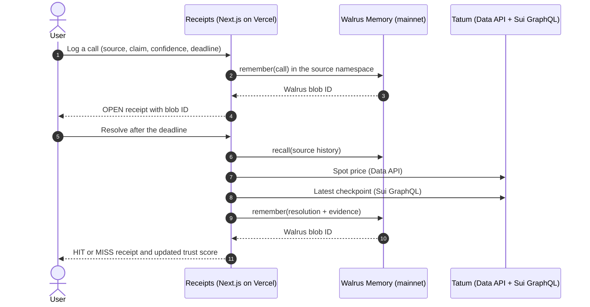

<div align="center">

# Receipts

### A credibility tracker for anyone who makes predictions.

Every call is stored in **Walrus Memory**, checked against real data from **Tatum**, and scored, so you can see who deserves your trust.


**Walrus x Tatum Hackathon: Total Recall** · Track 01: Markets & Sports Prediction

[Live demo](https://receipts-two-rho.vercel.app/) · [Demo video](https://youtu.be/0rq948BNKg8?si=CHAwA6xzFSkl9cYh) · [Blog post](https://receipts-blog-9do8.vercel.app)

<br />

[](https://youtu.be/0rq948BNKg8?si=CHAwA6xzFSkl9cYh)

*Click the thumbnail to watch the 2-minute demo.*

</div>

---

## Table of contents

1. [The problem](#the-problem)
2. [The solution](#the-solution)
3. [Quick links](#quick-links)
4. [Screenshots](#screenshots)
5. [Features](#features)
6. [How it works](#how-it-works)
7. [How Receipts uses Walrus Memory](#how-receipts-uses-walrus-memory)
8. [How Receipts uses Tatum](#how-receipts-uses-tatum)
9. [The trust score](#the-trust-score)
10. [Memory on vs memory off](#memory-on-vs-memory-off)
11. [Data model](#data-model)
12. [API reference](#api-reference)
13. [Tech stack](#tech-stack)
14. [Project structure](#project-structure)
15. [Getting started](#getting-started)
16. [Deploying to Vercel](#deploying-to-vercel)
17. [Verify it yourself](#verify-it-yourself)
18. [Hackathon judging criteria](#hackathon-judging-criteria)
19. [Known limitations](#known-limitations)
20. [Roadmap](#roadmap)
21. [Acknowledgments](#acknowledgments)

---

## The problem

People make bold predictions constantly: crypto influencers, sports tipsters, analysts, friends in a group chat. Almost nobody keeps score.

- A loud call that turns out wrong is quietly forgotten.
- A lucky guess looks the same as real skill.
- Confidence is never penalized, so the most overconfident voices are often the most visible.

Most apps forget everything between sessions. Without memory, there is no track record, and without a track record, there is nobody to trust.

## The solution

**Receipts keeps the score.**

1. You log a call: *"SUI will be at or above $1 by Friday, 70% sure."*
2. The call is written to **Walrus Memory** on mainnet, in that source's own namespace.
3. When the deadline passes, the app checks the real price through **Tatum**, and anchors the result to the Sui network.
4. The outcome is written back to Walrus Memory and printed as a **receipt** stamped **HIT** or **MISS**, with the Walrus blob ID as proof.
5. A source's **trust score** is recomputed from the memories recalled from Walrus, so it moves with every result.
6. When sources disagree about something new, Receipts can weight their opinions by track record instead of treating everyone equally.

The product gets sharper every time it resolves a call, because the learning lives in memory and not in the page.

## Quick links

| Resource | Link |
|---|---|
| Live app | https://receipts-two-rho.vercel.app/ |
| Demo video (2 min) | https://youtu.be/0rq948BNKg8?si=CHAwA6xzFSkl9cYh |
| Blog post | https://receipts-blog-9do8.vercel.app |
| Source code | https://github.com/Tihlumina/receipts |
| Hackathon | https://tatum.io/hackathon/total-recall |


## Features

| Feature | What it does | Powered by |
|---|---|---|
| Log a call | Records a prediction with the asset, direction, target, deadline, and stated confidence | Walrus Memory |
| Per-source namespaces | Each source's history is stored separately, so reputation is built only from its own record | Walrus Memory |
| Deadline-enforced resolution | The server refuses to resolve a call before its deadline | Server logic |
| Real-data checking | Prices are read from Tatum's Data API at resolution time | Tatum Data API |
| Sui checkpoint anchor | Every result is stamped with the latest Sui checkpoint number at check time | Tatum Sui GraphQL |
| Receipts | Each result prints as a thermal-paper receipt with a HIT or MISS stamp | UI |
| Proof barcode | The barcode on each receipt is generated from its Walrus blob ID | Walrus Memory |
| Calibration-based trust | Trust uses a Brier score, so a confident miss costs more than a cautious one | Trust engine |
| Trust timeline | A chart and one-line reasons show the score moving after every result | Recalled memories |
| Memory on/off toggle | The same question gives a different answer with and without recalled track records | Recalled memories |
| Source switcher | Move between sources and see each one's score, timeline, and open calls | UI |

## How it works



**Design principle:** trust scores are never stored. They are recomputed from the memories recalled from Walrus on every request. If the memory changes, the score changes, and that is the learning loop.

## How Receipts uses Walrus Memory

| Concept | Implementation |
|---|---|
| Network | Walrus Memory on **mainnet**, via the official TypeScript SDK (`@mysten-incubation/memwal`) |
| Isolation | One namespace per source (`src-<slug>`), created lazily and cached per server instance |
| Write path | `remember()` followed by `waitForRememberJob()`, returning the stored **blob ID** |
| Read path | `recall()` against the source's namespace, up to 100 memories, parsed and deduplicated |
| Memory types | `call` (a prediction) and `resolution` (its verified outcome) |
| Storage format | `RECEIPTS_V1 {json}`, a tagged JSON string, so unrelated text in a namespace is ignored |
| What is derived | Trust score, timeline, open calls, and the memory-weighted consensus, all from recalled data |
| Proof | Every receipt shows its blob ID, and the barcode is generated from it |

Every saved call and every result is its own mainnet write, so a normal session produces many memories.

## How Receipts uses Tatum

| Need | Tatum product | Used for |
|---|---|---|
| Asset prices | **Data API** (rate endpoint) | Deciding whether a price call was a HIT or MISS |
| Network anchor | **Sui GraphQL gateway** (`checkpoint`) | Stamping every result with the latest Sui checkpoint at check time |
| Wallet claims | **Sui GraphQL gateway** (`address.balance`) | Resolving "this wallet will hold X SUI" calls |
| Transaction claims | **Sui GraphQL gateway** (`transaction.effects.status`) | Helper for checking whether a transaction succeeded |

**Engineering note.** Tatum's Sui mainnet gateway advertises a GraphQL endpoint through its `/_methods` listing, and the JSON-RPC method this project first used returned `404`. All Sui reads therefore go through a single `gql()` function in `lib/tatum.ts`, which keeps any future protocol change to one place.

**What the checkpoint means.** It is a timestamp anchor to the state of Sui at the moment of checking. It does not prove the price itself.

## The trust score

Callers state a confidence between 50% and 99%. After each resolution, trust is calculated from the **Brier score**, which measures how far stated confidence was from what actually happened (0 is perfect, 0.25 is a coin flip).

```text
brier   = mean( (confidence - outcome)^2 )          outcome = 1 for a HIT, 0 for a MISS
skill   = 1 - brier
trust   = round( 100 * ( n * skill + 3 * 0.75 ) / ( n + 3 ) )
```

The score blends a source's record with a neutral prior (weight 3, skill 0.75), so one lucky call cannot make anyone look great, and every new source starts at **75**.

**Worked examples** (computed from the formula above):

| Record | Brier | Trust |
|---|---|---|
| No resolved calls | n/a | 75 |
| One MISS at 70% confidence | 0.490 | 69 |
| MISS at 90% and HIT at 60% (overconfident) | 0.485 | 66 |
| HITs at 80%, 80%, and 70% (well calibrated) | 0.057 | 85 |

A confident miss costs more than a cautious one, and a confident hit earns more than a hedge. That is what makes it a measure of *credibility* and not a simple hit counter.

## Memory on vs memory off

The "Who should you believe?" panel shows the product changing because of memory. Each source gives a probability for a new question, and Receipts combines them two ways:

| Mode | Weight given to each source | Meaning |
|---|---|---|
| Memory off | Equal | Everyone counts the same |
| Memory on | Proportional to trust recalled from Walrus | Reliable sources count more |

```text
consensus = sum( weight_i * probability_i ) / sum( weight_i )
```

The panel also reports how many points memory moved the answer. If every source has the same record, memory moves nothing, which is the honest result.

## Data model

Two memory types are written to Walrus, defined in `lib/types.ts`.

**Call**

```json
{
  "type": "call",
  "id": "uuid",
  "source": "Demo Analyst A",
  "claim": "SUI will be at or above $1 by 11/6/2026, 10:14:00 AM",
  "metric": { "kind": "price", "symbol": "SUI", "op": "gte", "target": 1 },
  "confidence": 0.7,
  "deadline": "2026-11-06T09:14:00.000Z",
  "createdAt": "2026-11-06T09:10:00.000Z"
}
```

**Resolution**

```json
{
  "type": "resolution",
  "callId": "uuid",
  "source": "Demo Analyst A",
  "hit": false,
  "confidence": 0.7,
  "evidence": {
    "observed": 0.86,
    "via": "tatum-data",
    "at": "2026-11-06T09:15:02.000Z",
    "lateSec": 62,
    "ref": "342585241"
  },
  "resolvedAt": "2026-11-06T09:15:02.000Z"
}
```

| Field | Notes |
|---|---|
| `metric.kind` | `price` (USD, Tatum Data API) or `sui_balance` (SUI, Tatum Sui GraphQL) |
| `metric.op` | `gte` (at or above) or `lte` (at or below) |
| `evidence.lateSec` | How many seconds after the deadline the check ran, recorded for honesty |
| `evidence.ref` | The Sui checkpoint number at check time |

## API reference

| Method | Route | Purpose | Key inputs | Returns |
|---|---|---|---|---|
| `POST` | `/api/calls` | Log a call and write it to Walrus | `source`, `claim`, `metric`, `confidence` (0.5 to 0.99), `deadline` | `call`, `blobId` |
| `POST` | `/api/resolve` | Check a call against Tatum and write the result | `source`, `callId` | `resolution`, `blobId`, `trust`, `series` |
| `GET` | `/api/trust?source=` | Recall a source's history and compute its trust | `source` | `trust`, `brier`, `resolved`, `series`, `open` |
| `GET` | `/api/smoke` | Health check across Tatum, Sui, and Walrus | none | Price, checkpoint, Walrus write and read-back |

`/api/resolve` returns `404` if the call is not in the source's memory, `409` if it is already resolved, and `422` if the deadline has not passed.

## Tech stack

| Layer | Technology |
|---|---|
| Framework | Next.js 16 (App Router), React, TypeScript |
| Styling | Tailwind CSS 4, custom design tokens |
| Type | Fraunces, Instrument Sans, JetBrains Mono |
| Memory | Walrus Memory TypeScript SDK on mainnet |
| Data | Tatum Data API and Tatum Sui GraphQL gateway |
| Hosting | Vercel |

## Project structure

```text
receipts/
├── app/
│   ├── api/
│   │   ├── calls/route.ts      Log a call, write to Walrus
│   │   ├── resolve/route.ts    Resolve a call with Tatum, write the result
│   │   ├── trust/route.ts      Recall history, compute trust and timeline
│   │   └── smoke/route.ts      End-to-end health check
│   ├── globals.css             Design tokens and shared styles
│   ├── layout.tsx              Root layout and fonts
│   └── page.tsx                Main screen
├── components/
│   ├── Receipt.tsx             Thermal-paper receipt with blob-ID barcode
│   ├── OpenCalls.tsx           Source header, open calls, and results
│   ├── TrustTimeline.tsx       Trust chart and per-result reasons
│   └── Consensus.tsx           Memory on/off panel
└── lib/
    ├── memory.ts               Walrus Memory read and write, namespaces
    ├── tatum.ts                Tatum Data API and Sui GraphQL
    ├── resolver.ts             Deadline check and call resolution
    ├── trust.ts                Brier score, trust, series, consensus
    └── types.ts                Memory schema
```

## Getting started

**Prerequisites:** Node.js 20 or newer, a [Tatum](https://dashboard.tatum.io) account, and a [Walrus Memory](https://memory.walrus.xyz) mainnet account with a delegate key.

```bash
git clone https://github.com/Tihlumina/receipts.git
cd receipts
npm install
```

Create a file named `.env.local` in the project root:

```bash
# Walrus Memory (mainnet)
MEMWAL_PRIVATE_KEY=
MEMWAL_ACCOUNT_ID=
MEMWAL_SERVER_URL=https://relayer.memory.walrus.xyz

# Tatum
TATUM_API_KEY=

# Optional: override the Sui GraphQL endpoint
# TATUM_SUI_GRAPHQL_URL=https://sui-mainnet.gateway.tatum.io/graphql
```

| Variable | Required | Where to get it |
|---|---|---|
| `MEMWAL_PRIVATE_KEY` | Yes | Delegate key created in the Walrus Memory dashboard |
| `MEMWAL_ACCOUNT_ID` | Yes | Your Walrus Memory account ID (your own, not one copied from docs) |
| `MEMWAL_SERVER_URL` | Yes | The mainnet relayer: `https://relayer.memory.walrus.xyz` |
| `TATUM_API_KEY` | Yes | Tatum dashboard |
| `TATUM_SUI_GRAPHQL_URL` | No | Defaults to Tatum's Sui mainnet GraphQL gateway |

Never commit `.env.local`. It is already covered by `.gitignore`.

```bash
npm run dev
```

Open http://localhost:3000, then open http://localhost:3000/api/smoke. A healthy run returns a Tatum price, a Sui checkpoint, and a Walrus write with `roundTrip: true`.

## Deploying to Vercel

1. Push the repository to GitHub.
2. In Vercel, choose **Add New**, then **Project**, and import the repository.
3. Add the four environment variables from the table above.
4. Deploy, then open `/api/smoke` on the live URL to confirm all three services respond.

## Verify it yourself

| Check | How |
|---|---|
| Mainnet writes | Every receipt shows a `walrus:` blob ID, and each saved call and each result is a separate write |
| Tatum Data API | Resolve a call and compare the observed price on the receipt with a live SUI price |
| Tatum Sui GraphQL | The receipt's **Sui checkpoint** row is read from Tatum's gateway at check time |
| Learning loop | Resolve calls for two sources and watch their trust scores diverge |
| Memory effect | Flip **Memory on** and **Memory off** and watch the consensus change |
| Pipeline health | Open `/api/smoke` |

## Hackathon judging criteria

| Criterion | Weight | How Receipts addresses it |
|---|---|---|
| Walrus and Tatum integration | 30% | Per-source Walrus namespaces, structured call and resolution memories, trust derived entirely from recalled memory, Tatum Data API for prices, Tatum Sui GraphQL for checkpoints and on-chain claims |
| Technical quality | 30% | Typed memory schema, a single Sui query entry point, deadline enforcement with recorded lateness, deduplicated recall, an end-to-end smoke endpoint |
| Creativity | 20% | Predictions as receipts, proof barcodes generated from blob IDs, calibration-based (Brier) credibility, a memory on/off comparison |
| Presentation | 20% | Live demo, demo video, blog post, and this documentation |

**Track:** 01 Markets & Sports Prediction, where memory stores credibility scores so the app learns who to trust.
**Special award targeted:** Best Walrus Memory, for a learning loop where memories visibly change the product.

## Known limitations

| Limitation | Detail |
|---|---|
| Price timing | The price is read when you press Resolve, not at the exact deadline. The delay is stored as `lateSec` |
| Source identity | Sources are free-text names with no authentication, so a trust score belongs to a name, not a verified person |
| Recall size | Recall returns up to 100 memories per source |
| Manual resolution | Calls are resolved by a button press, with no scheduled resolver yet |
| Demo data | The demo sources and their calls are fictional and exist only to show the learning loop |
| Beta dependency | Walrus Memory is in beta, and writes can occasionally take longer than usual |

## Roadmap

| Item | Status |
|---|---|
| Log calls, resolve against Tatum, receipts, trust timeline | Done |
| Memory on/off consensus | Done |
| Sui checkpoint anchor on every result | Done |
| On-chain claims (wallet balances) in the call form | Next |
| Scheduled auto-resolution at each deadline | Next |
| Historical price at the exact deadline | Next |
| Paste a post and extract the structured call | Planned |
| Shareable receipt images | Planned |
| Sports odds comparison and more asset types | Planned |
| Pay-per-lookup trust scores with x402 on Sui | Planned |
| Mobile app with Expo | Planned |

## Acknowledgments

Built for the **Walrus x Tatum Hackathon: Total Recall**. Thanks to the [Walrus Foundation](https://www.walrus.xyz) for Walrus Memory and to [Tatum](https://tatum.io) for the Data API and Sui gateway.

<div align="center">

**Receipts** · Keep the score.

Built by TIHLUMINA · [@Tihlumina](https://x.com/tihlumina?s=11)

</div>
